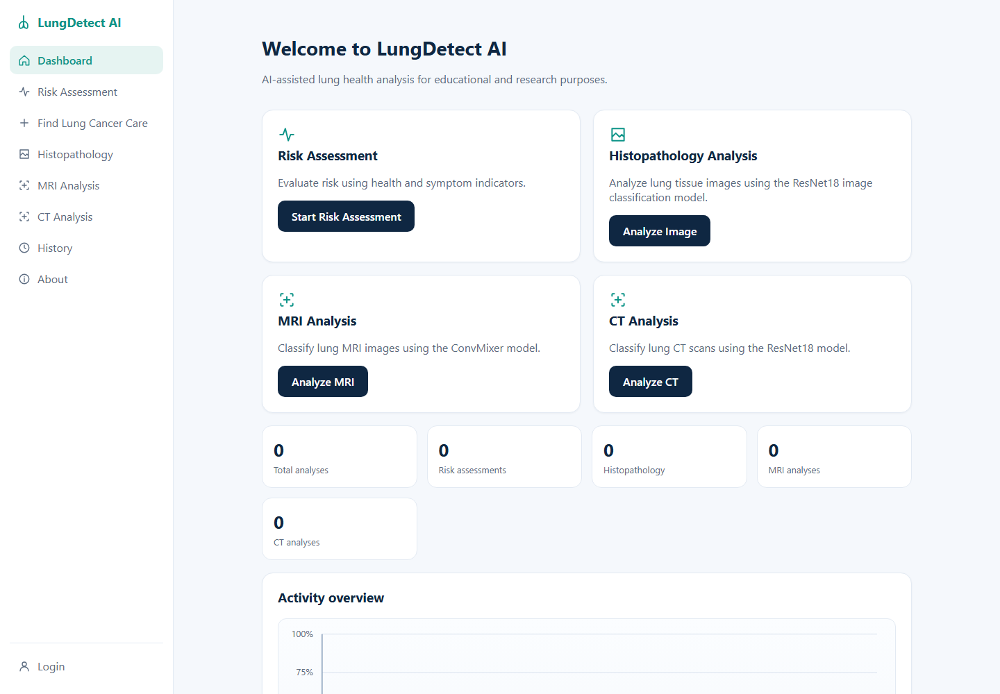
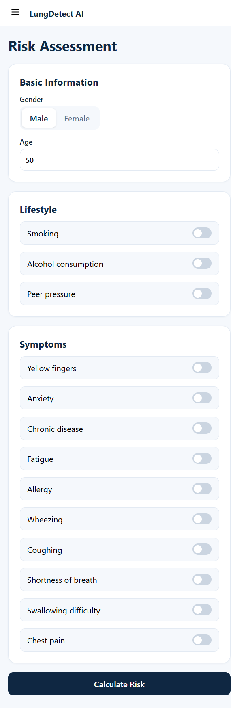
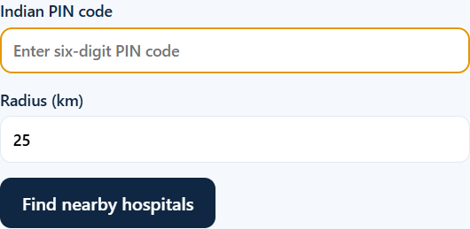
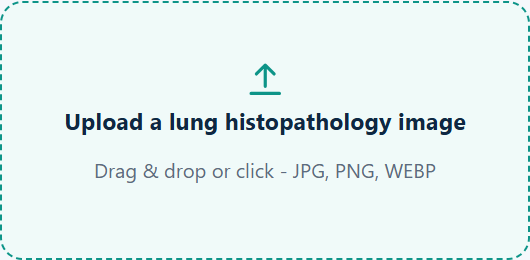
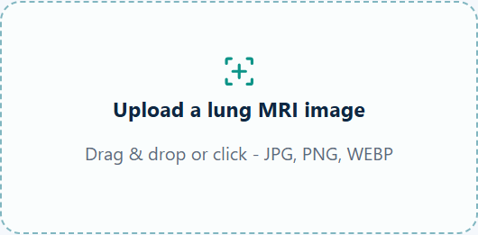
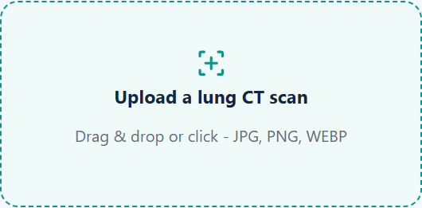
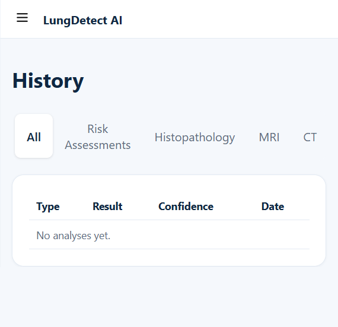

# LungDetect AI

LungDetect AI is an educational prototype combining symptom-based risk scoring with three independent image-classification workflows: lung histopathology, lung MRI, and lung CT analysis. It includes a React/Vite dashboard, FastAPI inference service, modality-aware AI chat through Ollama, and optional Supabase authentication and persistence.

> **Medical and data notice:** This application is not a diagnostic device and must not guide treatment decisions. Model scores are experimental, not clinically calibrated probabilities. Use synthetic or de-identified data only; this project is not designed for identifiable medical records or HIPAA-regulated use.

## Features

- Symptom-based Gaussian Naive Bayes prediction with score and confidence metrics.
- ResNet18 histopathology classification for `lung_aca`, `lung_n`, and `lung_scc`.
- ConvMixer MRI classification for `cancer` and `no_cancer`.
- ResNet18 CT classification for `benign`, `malignant`, and `normal`.
- Configurable image confidence threshold; low-confidence images are classified as `unknown` for review.
- Modality validation that flags obvious cross-modality uploads as `unknown` for manual verification.
- Risk-, pathology-, MRI-, and CT-specific chat using local Ollama by default; OpenAI is optional.
- Supabase email/password authentication; user-scoped risk, histopathology, MRI, and CT analysis records; private modality-specific image storage; and chat history protected by row-level security (RLS).
- Nearby verified-provider search asks only for an Indian PIN code and search radius. Results are sorted by straight-line distance; ownership is shown only as recorded in Supabase.
- Training and preprocessing scripts with evaluation plots and saved artifacts.

## Frontend tour

The screenshots below show the responsive frontend with an empty demo history. No patient
images or account records are included.

### Dashboard



The sidebar buttons open **Dashboard**, **Risk Assessment**, **Find Lung Cancer Care**,
**Histopathology**, **MRI Analysis**, **CT Analysis**, **History**, and **About**.
On the Dashboard, **Start Risk Assessment**, **Analyze Image**, **Analyze MRI**, and
**Analyze CT** open their respective workflows. The totals and activity chart summarize
the signed-in user's saved analyses.

### Risk assessment



Choose the gender option, enter age, and switch the lifestyle and symptom toggles as
appropriate. **Calculate Risk** submits the form. After the result appears, **New
assessment** returns to the form; the result panel also offers suggested questions and a
message box with **Send** for the context-aware assistant.

### Find nearby cancer care



Enter an Indian six-digit PIN code and a search radius from 1 to 100 km, then choose
**Find nearby hospitals**. The results list includes only database records marked
verified; distance is approximate straight-line distance, and government/private status
is displayed as stored rather than inferred. Result links can open **View directions**,
the **Official website**, a phone number, or appointment page when that information is
available. **Retry** appears if a search returns an error.

### Image analysis







For Histopathology, MRI, or CT, drag an image onto the upload area or click it to choose
a JPG, PNG, or WEBP file. After choosing a file, **Analyze Image**, **Analyze MRI**, or
**Analyze CT** runs that modality's model; **Remove** clears the selected file before
analysis. The result area explains the experimental class and score and offers suggested
assistant questions plus **Send**. Unsupported files, oversized MRI/CT files, and
unrecognized or low-confidence images show validation or manual-review feedback.

### History and account



The History buttons **All**, **Risk Assessments**, **Histopathology**, **MRI**, and
**CT** filter the signed-in user's saved analysis rows. **Login** opens the sign-in form;
**Create Account** switches to registration, and **Back** returns to the app. After
sign-in, the sidebar account button signs out.

## Technology

| Area | Technology |
| --- | --- |
| Frontend | React 18, Vite 5, JavaScript/JSX |
| Frontend auth/data/storage | Supabase JavaScript client, Supabase Auth, PostgreSQL, Supabase Storage, RLS |
| Backend API | Python, FastAPI, Pydantic, Uvicorn, `python-multipart` |
| Tabular ML | pandas, NumPy, scikit-learn, joblib; Gaussian Naive Bayes and preprocessing encoders/scaler |
| Image ML | PyTorch, torchvision, ResNet18, ConvMixer, Pillow |
| Chat | Ollama `llama3.2:3b` by default; optional OpenAI-compatible chat API |
| Data/model analysis | matplotlib, seaborn, Plotly, XGBoost, LightGBM, CatBoost, SHAP, Optuna |

## Project Structure

The tree below shows the current source layout and the local data/model paths used by the application. Datasets, uploaded images, trained weights, generated plots, local environments, build output, `.env.local`, and `node_modules` are local/generated files and may not appear in a fresh clone.

```text
Early Cancer Detection/
├── .gitignore
├── README.md
├── evaluate_model.py
├── lung_cancer.csv
├── railway.json
├── start-app.ps1
├── Backend/
│   ├── app.py
│   ├── ct_predict.py
│   ├── dataset_predict.py
│   ├── image_predict.py
│   ├── modality_validation.py
│   ├── mri_predict.py
│   ├── predict.py
│   ├── preprocess.py
│   ├── requirements.txt
│   ├── test_image.py
│   ├── test_mri_predict.py
│   ├── train.py
│   ├── train_ct_resnet18.py
│   ├── train_image_model.py
│   └── train_mri_convmixer.py
├── Data/
│   ├── ct_scan/
│   │   ├── extracted/
│   │   │   └── The IQ-OTHNCCD lung cancer dataset/
│   │   │       └── The IQ-OTHNCCD lung cancer dataset/
│   │   └── uploads/
│   ├── histopathology/
│   │   ├── lung_aca/
│   │   ├── lung_n/
│   │   ├── lung_scc/
│   │   ├── unknown/            # Legacy/manual-review data; never a training class
│   │   └── uploads/
│   ├── mri/
│   │   ├── lung_cancer_MRI_dataset/
│   │   └── uploads/
│   ├── lung_cancer.csv
│   ├── lung_cancer_prediction.csv
│   ├── processed.csv
│   ├── X_test.pkl
│   ├── X_train.pkl
│   ├── y_test.pkl
│   └── y_train.pkl
├── frontend/
│   ├── .env.example
│   ├── .env.local
│   ├── index.html
│   ├── package.json
│   ├── package-lock.json
│   ├── vite.config.js
│   └── src/
│       ├── App.jsx
│       ├── main.jsx
│       ├── components/
│       │   ├── Assistant.jsx
│       │   ├── Auth.jsx
│       │   ├── CT.jsx
│       │   ├── Histo.jsx
│       │   ├── MRI.jsx
│       │   ├── Pages.jsx
│       │   ├── Risk.jsx
│       │   └── ui.jsx
│       ├── services/
│       │   ├── api.js
│       │   ├── persistence.js
│       │   └── supabase.js
│       └── styles/
│           └── app.css
├── Kaggle_Output/
│   └── lung-cancer-prediction.log
├── models/                       # Local trained checkpoints and metadata
├── plots/                        # Local evaluation plots
└── supabase/
    ├── schema.sql
    └── seed_mumbai_mmr.sql
```

### Key modules

- `Backend/app.py`: health, tabular risk, image-analysis, and AI-chat API routes.
- `Backend/providers.py`: validates PIN searches, reads verified Supabase providers, and applies straight-line radius filtering using local coordinates.
- `Backend/pin_coordinates.py`: local reference coordinates for supported PIN-code search origins.
- `Backend/predict.py`: loads the saved tabular model, scaler, and encoders.
- `Backend/dataset_predict.py`: loads the separate experimental `Final_Prediction` pipeline used by `/predict-dataset`.
- `Backend/image_predict.py`: loads the histopathology ResNet18 model, applies the image threshold, and stores uploaded images only under `Data/histopathology/uploads/`; model predictions never route uploads into training classes.
- `Backend/mri_predict.py`: loads the ConvMixer MRI checkpoint and returns binary MRI class scores.
- `Backend/ct_predict.py`: loads the ResNet18 CT checkpoint and returns benign/malignant/normal class scores.
- `Backend/modality_validation.py`: flags obvious cross-modality uploads as unknown before classification.
- `Backend/preprocess.py`, `train.py`, `train_image_model.py`, `train_mri_convmixer.py`, `train_ct_resnet18.py`: preprocessing and model training/evaluation pipelines.
- `frontend/src/App.jsx`: navigation, Supabase session handling, saved history, and analysis gating.
- `frontend/src/services/api.js`: browser-to-FastAPI requests.
- `frontend/src/services/supabase.js`, `persistence.js`: Supabase client and user-scoped persistence.
- `frontend/src/components/Risk.jsx`, `Histo.jsx`, `MRI.jsx`, `CT.jsx`, `Assistant.jsx`: prediction forms/results, modality introductions, and context-aware chat.
- `supabase/schema.sql`: tables, grants, RLS rules, private bucket and storage policies; also requests a PostgREST schema-cache refresh.
- `supabase/seed_mumbai_mmr.sql`: source-attributed MMR postal-code centroids and additional oncology provider records.

### Verified provider search

Run `supabase/schema.sql` in the Supabase SQL editor before using `GET /api/providers`
or saving analysis data. It creates the user-owned MRI and CT analysis tables and
private scan-image buckets in addition to the existing analyses, chat, and providers schema.
Then run `supabase/seed_mumbai_mmr.sql` to add mapped Mumbai Metropolitan Region PIN
codes and source-verified oncology providers. It loads 182 PIN records across Mumbai,
Mumbai Suburban, Thane, Palghar, and selected Raigad/Navi Mumbai areas. The seed is safe
to rerun. These are directory entries, not a clinical ranking or endorsement.
The provider section includes an additive migration for `ownership_type`,
`lung_cancer_expertise`, `multidisciplinary_care`, `diagnostic_capabilities`,
`address_verified`, `government_supported`, `charitable_assistance`, and
`cost_information`. Populate those fields only from documented evidence. Existing rows
default to conservative values and remain searchable only when `verified = true`.
Add provider records only after confirming their specialty, location, services, source link,
and verification date. New records must have `verified = false` until that review is
complete; the API reads only records marked verified. Do not duplicate existing institutions
or infer ownership from a provider name. Ownership is displayed from `ownership_type`;
unknown values are shown as not specified.

Configure these backend environment variables:

- `SUPABASE_URL`: Supabase project URL.
- `SUPABASE_PUBLISHABLE_KEY`: Supabase publishable key used as the REST API key.
- `SUPABASE_ANON_KEY`: Supabase publishable/anonymous key used to read the public verified-provider policy.

Copy `Backend/.env.example` to a local, untracked environment file or configure the same
variables in the deployment platform. The provider lookup uses Supabase REST and does not
need a PostgreSQL password. The frontend must use only `VITE_SUPABASE_URL` and
`VITE_SUPABASE_ANON_KEY`.

Replace the example URL and key in `Backend/.env` with the project URL and publishable
(or legacy anon) key from Supabase Project Settings → API, then restart the backend.
The example values are not usable credentials. Keep this backend file private and never
use a `service_role` key in the frontend.

Example:

```text
GET /api/providers?pin=401303&radius_km=25
```

The response labels distances as `straight_line`; they are not driving distances. PIN centers
are approximate post-office coordinate averages, not exact household locations. The seed
includes postal areas mapped from Mumbai, Mumbai Suburban, Thane, Palghar, and selected
Raigad/Navi Mumbai districts. If no verified records match,
the frontend displays an explicit empty state rather than showing unverified leads. Provider
records are fetched from PostgREST in bounded pages so a single upstream response limit does
not silently truncate the directory.

## Requirements

- Windows PowerShell (the launcher is `start-app.ps1`).
- Python with dependencies from `Backend/requirements.txt` and a supported PyTorch/torchvision installation.
- Node.js and npm.
- Ollama plus the configured chat model for local AI chat.
- A Supabase project for accounts and cloud persistence.

The public source release does **not** include training datasets or trained model files. The backend loads tabular artifacts plus `models/lung_resnet18.pth`, `models/lung_mri_convmixer.pth`, and `models/ct_resnet18.pth` when available; inference will not start until these are obtained under suitable terms or generated locally from licensed training data.

## 📊 Datasets Used

| Dataset | Owner / original contributors | Used for | Technology / model | Link |
| --- | --- | --- | --- | --- |
| Lung and Colon Cancer Histopathological Images (LC25000) | Original contributors: Andrew A. Borkowski, Marilyn M. Bui, L. Brannon Thomas, Catherine P. Wilson, L. A. DeLand, and Stephen M. Mastorides. Kaggle upload by AndrewMVD (Larxel). | Lung histopathology classification | PyTorch + ResNet18, transfer learning | [Kaggle dataset](https://www.kaggle.com/datasets/andrewmvd/lung-and-colon-cancer-histopathological-images) · [Original GitHub](https://github.com/tampapath/lung_colon_image_set) |
| Lung Cancer MRI Images | Kaggle contributor: `xiaopengzhang12`; dataset attribution belongs to the original dataset contributors listed on the dataset page. | Lung MRI classification | PyTorch + ConvMixer, transfer learning | [Kaggle dataset](https://www.kaggle.com/datasets/xiaopengzhang12/lung-cancer-mri-images) |
| IQ-OTH/NCCD Lung Cancer Dataset | Original dataset authors include Hamdalla F. Al-Yasriy and contributors; the Kaggle upload is by `adityamahimkar`. | Lung CT classification | PyTorch + ResNet18, transfer learning | [Kaggle dataset](https://www.kaggle.com/datasets/adityamahimkar/iqothnccd-lung-cancer-dataset) |

### Dataset Details

#### LC25000: Lung and Colon Cancer Histopathological Images

LC25000 contains **25,000 histopathological images** across five classes. This project uses the lung portion: normal lung tissue (`lung_n`), lung adenocarcinoma (`lung_aca`), and lung squamous cell carcinoma (`lung_scc`). The dataset contains 5,000 images per class and was augmented using the Augmentor package.

**Technology:** Python, PyTorch, ResNet18, transfer learning, CUDA, RTX 2050, Torchvision, and image preprocessing.

**Original citation:**

> Borkowski AA, Bui MM, Thomas LB, Wilson CP, DeLand LA, Mastorides SM. *Lung and Colon Cancer Histopathological Image Dataset (LC25000).* arXiv:1912.12142, 2019.

#### Lung Cancer MRI Images

The MRI component uses the Kaggle **Lung Cancer MRI Images** dataset uploaded by `xiaopengzhang12`. It trains a binary classifier for `cancer` and `no_cancer` using ConvMixer, ImageNet normalization, CUDA, and the NVIDIA RTX 2050.

#### IQ-OTH/NCCD Lung Cancer Dataset

The IQ-OTH/NCCD dataset contains CT scan images grouped into normal, benign, and malignant categories. The original dataset was collected through the Iraq-Oncology Teaching Hospital / National Center for Cancer Diseases. This project uses it to train a three-class ResNet18 CT classifier with a stratified split and class-weighted CrossEntropyLoss.

**Original citation:** H. F. Al-Yasriy, M. S. Al-Husieny, F. Y. Mohsen, E. A. Khalil, and Z. S. Hassan, *Diagnosis of Lung Cancer Based on CT Scans Using CNN*, IOP Conference Series: Materials Science and Engineering, 2020. See the Kaggle dataset page for the associated record and attribution details.

## 🧠 Technology Stack

### Machine Learning

- Python
- PyTorch
- Torchvision
- Scikit-learn
- NumPy
- Pandas

### Deep Learning Models

- **ResNet18** — Histopathology
- **ConvMixer** — MRI
- **ResNet18** — CT scans
- **Gaussian Naive Bayes** — Symptom-based risk prediction

### Hardware Acceleration

- NVIDIA GeForce RTX 2050
- CUDA
- GPU-accelerated PyTorch

### Image Processing

- PIL / Pillow
- Torchvision transforms
- Image normalization and augmentation
- Modality and image-quality validation

### Backend and Frontend

- FastAPI and Uvicorn
- React and Vite
- JavaScript, JSX, HTML, and CSS

### Database and Development

- Supabase Auth, PostgreSQL, Storage, and RLS
- Ollama or OpenAI-compatible chat
- Git, GitHub, and VS Code

## Setup

### 1. Install Python and JavaScript dependencies

From the project root, create/activate a Python virtual environment if one is not already present, then install backend requirements:

```powershell
python -m venv .venv
Set-ExecutionPolicy -Scope Process -ExecutionPolicy RemoteSigned
.\.venv\Scripts\Activate.ps1
python -m pip install -r Backend\requirements.txt
```

Install frontend packages:

```powershell
Push-Location frontend
npm install
Pop-Location
```

The supplied launcher also recognizes `.venv-2` and `.venv` at the project root.

### 1a. Provide licensed datasets and model artifacts

Obtain each dataset and pre-trained artifact from its authorized source, review its license, and place it in the paths shown above. The app is educational and the repository does not redistribute these files. For the tabular pipeline, provide the expected `.csv` input and train using the scripts below. For image training, place the licensed histopathology, MRI, and CT datasets in their corresponding `Data/` paths before running the respective training scripts.

### 2. Configure Supabase

1. Create a Supabase project and enable email/password sign-in in **Authentication**.
2. Set the local site/redirect URL to `http://localhost:3000` in the Supabase URL configuration.
3. In **SQL Editor**, run [`supabase/schema.sql`](supabase/schema.sql), then run [`supabase/seed_mumbai_mmr.sql`](supabase/seed_mumbai_mmr.sql). The schema creates the user-scoped analysis and chat tables, enables RLS, and provisions private pathology, MRI, and CT image buckets. The seed adds source-attributed PIN coordinates and cancer-care providers.
4. Copy the frontend environment template:

   ```powershell
   Copy-Item frontend\.env.example frontend\.env.local
   ```

5. In `frontend/.env.local`, set `VITE_SUPABASE_URL` and `VITE_SUPABASE_ANON_KEY` from the Supabase project API settings. The Vite prefix must be `VITE_`. Never put a database password or `service_role` key in frontend configuration.
6. Restart Vite after changing the env file. If PostgREST reports missing tables or schema-cache errors, rerun `schema.sql` and refresh the app.

Supabase stores full risk answers/results, MRI and CT model-result JSON, image MIME type and size, chat messages, and uploaded histopathology, MRI, and CT images in private modality-specific buckets. MRI and CT records use separate `mri_analyses` and `ct_scan_analyses` tables. RLS scopes rows, chat references, and image paths to the signed-in user. The backend keeps local copies of image uploads in each modality's `uploads/` directory; these are separate from both the original training class folders and the private Supabase bucket. Deleting cloud data does not remove local upload copies.

The PIN seed uses the India Post All India Pincode Directory
([data.gov.in dataset](https://data.gov.in/node/6818285)); post-office coordinates are
aggregated to approximate PIN-area centers. OpenStreetMap coordinates are attributed to
OpenStreetMap contributors under ODbL 1.0. Provider locations and specialties link to
official hospital pages; directory records are not a recommendation or “best hospital” ranking.

### 3. Install and configure local AI chat

Install Ollama from its official distribution, then pull the default model:

```powershell
ollama pull llama3.2:3b
```

The backend defaults to `AI_PROVIDER=ollama`, model `llama3.2:3b`, and `http://127.0.0.1:11434`. Optional settings are `OLLAMA_MODEL` and `OLLAMA_BASE_URL`. For OpenAI instead, set `AI_PROVIDER=openai`, `OPENAI_API_KEY`, and optionally `OPENAI_MODEL` in the backend process environment. OpenAI mode sends prompt context to OpenAI; local Ollama mode runs locally. Histopathology chat sends class/result metadata, not the image itself.

### 4. Start the app

From the project root:

```powershell
Set-ExecutionPolicy -Scope Process -ExecutionPolicy RemoteSigned
.\start-app.ps1
```

Open `http://localhost:3000`. The API is at `http://127.0.0.1:5050`; interactive API docs are at `http://127.0.0.1:5050/docs`.

## Deploying to Vercel and Railway

Deploy the `frontend` directory as a Vercel project and the repository root as a separate Railway service.

### Railway backend

1. Create a Railway service from this repository and leave its **Root Directory** at the repository root.
2. Railway will install `Backend/requirements.txt` and use `railway.json` to start Uvicorn on Railway's `$PORT`.
3. After deployment, copy the generated Railway public URL, for example `https://your-api.up.railway.app`.
4. Set these Railway variables:
    - `AI_PROVIDER=openai`
    - `OPENAI_API_KEY=...`
    - Optional: `OPENAI_MODEL=gpt-4o-mini`
    - Optional: `HISTOPATHOLOGY_CONFIDENCE_THRESHOLD=70`

Ollama cannot use the default `127.0.0.1` address from a hosted Railway container. Use OpenAI mode, or host a reachable OpenAI-compatible provider and set `AI_PROVIDER` and `OLLAMA_BASE_URL` accordingly.

The ignored model artifacts are required at deploy time: `models/gaussian_nb.pkl`, `models/scaler.pkl`, `models/encoders.pkl`, and `models/lung_resnet18.pth`. Supply them through a private artifact workflow or an authorized private deployment source; a clean source-only checkout will fail during backend startup without them. Railway's local filesystem is also ephemeral, so use Supabase Storage for durable user uploads rather than relying on the backend's local review archive.

### Vercel frontend

1. Create a Vercel project from the same repository and set its **Root Directory** to `frontend`.
2. Use `npm run build` as the build command and `dist` as the output directory.
3. Set these Vercel variables for the Production environment:
    - `VITE_API_URL=https://your-api.up.railway.app`
    - `VITE_SUPABASE_URL=https://your-project.supabase.co`
    - `VITE_SUPABASE_ANON_KEY=your-supabase-publishable-or-anon-key`
4. Add the final Vercel URL to Supabase Authentication's allowed site and redirect URLs.

The included `frontend/vercel.json` keeps client-side routes working after a page refresh. Redeploy Vercel after changing any `VITE_` variable because Vite embeds those values at build time.

**Launcher note:** `start-app.ps1` stops processes listening on ports 5050 and 3000 before starting both servers. Use manual startup if those ports contain processes you need to keep.

Manual startup, in separate PowerShell terminals from the project root:

```powershell
# Backend (activate the project venv first)
$env:AI_PROVIDER = "ollama"
python -m uvicorn --app-dir Backend app:app --host 127.0.0.1 --port 5050
```

```powershell
# Frontend
Push-Location frontend
npm run dev -- --host 0.0.0.0 --port 3000
```

## Using the app

1. Configure Supabase and sign in or create an account.
2. In **Risk Assessment**, submit age, gender, and symptom indicators. Indicator values are encoded as `1 = No`, `2 = Yes`; gender is `M` or `F`.
3. The backend returns the Gaussian Naive Bayes result. The result screen offers a context-aware chat; medication questions are directed to a clinician/pharmacist, not prescribed.
4. In **Histopathology**, upload a JPG/JPEG, PNG, or WEBP image and analyze it. Low-confidence results (default threshold 70%) and obvious modality mismatches are marked `unknown` for manual verification; every retained upload stays under `Data/histopathology/uploads/`.
5. In **MRI Analysis** or **CT Analysis**, upload the corresponding image. MRI returns `cancer` or `no_cancer`; CT returns `benign`, `malignant`, or `normal`. Obvious cross-modality uploads are returned as `unknown`.
6. Image uploads are content-validated, limited to 10 MB, and stored locally under the matching modality's `uploads/` folder with generated filenames; prediction labels never determine a storage folder. Signed-in analysis images are also stored separately in the private Supabase bucket.
7. The image assistants receive class scores and result metadata, not the uploaded image. The model scores are uncalibrated outputs and are not clinical disease probabilities.
8. **History** and dashboard totals show saved analyses for the signed-in Supabase user.

## API

Base URL: `http://127.0.0.1:5050`.

| Method and route | Purpose |
| --- | --- |
| `GET /` | API welcome/status response |
| `GET /health` | Health check |
| `POST /predict` | Accepts the patient JSON fields and returns `{ "success": true, "prediction": { ... } }` with model, prediction, cancer score, survival estimate, and confidence |
| `POST /predict-image` | Accepts multipart form field `file`; supports JPEG, PNG, WEBP; returns histopathology class scores, threshold, storage class, and manual-review flag |
| `POST /predict-mri` | Accepts multipart form field `file`; returns MRI class scores or `unknown` when the image fails the modality gate |
| `POST /predict-ct` | Accepts multipart form field `file`; returns CT class scores or `unknown` when the image fails the modality gate |
| `POST /assistant/chat` | Accepts a message, recent chat history, result context, `context_type` (`risk`, `histopathology`, `mri`, or `ct`), and optional patient indicators; returns an AI reply |

The image confidence threshold is configurable with `HISTOPATHOLOGY_CONFIDENCE_THRESHOLD` in the backend environment. The default is 70 percent. This is an experimental review threshold, not proof that an image is valid or in-distribution.

## Training and data pipeline

Run commands from the project root with the Python environment activated:

```powershell
python Backend\preprocess.py
python Backend\train.py
python Backend\train_image_model.py
python Backend\train_convmixer.py
python Backend\train_ct_improved.py
```

`preprocess.py` prepares the tabular data and plots. `train.py` evaluates the tabular classifiers and writes fitted model/scaler/encoder artifacts under `models/` and split data under `Data/`. `train_image_model.py` trains ResNet18 only from direct image files in the `lung_aca`, `lung_n`, and `lung_scc` class folders and writes `models/lung_resnet18.pth`. `train_convmixer.py` trains ConvMixer from the `train/` and `validate/` class folders under `Data/mri/lung_cancer_MRI_dataset/` and writes `models/lung_mri_convmixer.pth`. The legacy `train_mri_improved.py` also reads only those two MRI classes but saves a separate checkpoint under `Backend/outputs/`; it is not the checkpoint used by inference. `train_ct_improved.py` trains CT ResNet18 from the three named IQ-OTHNCCD class folders. These image trainers select only files directly inside the explicitly named training classes; uploads, unknown, and other non-class directories are excluded. Histopathology trainers also skip UUID-named JPGs produced by the previous upload behavior. Never copy internet-downloaded test images or application uploads into source class folders; manually audit any other files copied there because their provenance cannot be inferred. Trained artifacts are required to run inference; they are not regenerated when the app starts.

## Publishing and large files

This source-only release excludes datasets, patient/image data, trained model artifacts, and generated plots because redistribution rights have not been confirmed and the image corpus is large. Never commit `.env.local`, API keys, database passwords, or Supabase `service_role` credentials. If you later confirm redistribution rights, review file sizes and licenses before changing `.gitignore`; large files may require Git LFS.

## Safety and privacy

- Educational/research prototype only; not a diagnosis, screening recommendation, prognosis, or treatment plan.
- Do not use the prototype to decide whether to start, stop, or change medication. Chat is not medical care; seek a qualified clinician/pathologist for interpretation.
- High tabular risk scores trigger clinician follow-up guidance; severe breathing difficulty, coughing blood, severe chest pain, or sudden deterioration warrants urgent medical care.
- Histopathology `unknown` means the model score fell below its experimental threshold. It cannot determine whether the input was invalid, out of distribution, or a model failure.
- MRI and CT `unknown` means the image failed the conservative modality gate or requires manual verification. The gate is not a certified medical image-authentication system.
- Supabase Auth and RLS protect per-user cloud data, but the project has not been security-audited or certified for clinical records. Use synthetic or de-identified data only.
- By default the chat model runs locally via Ollama. If OpenAI is configured, risk inputs/chat context are sent to that provider. Review provider data terms before use.
